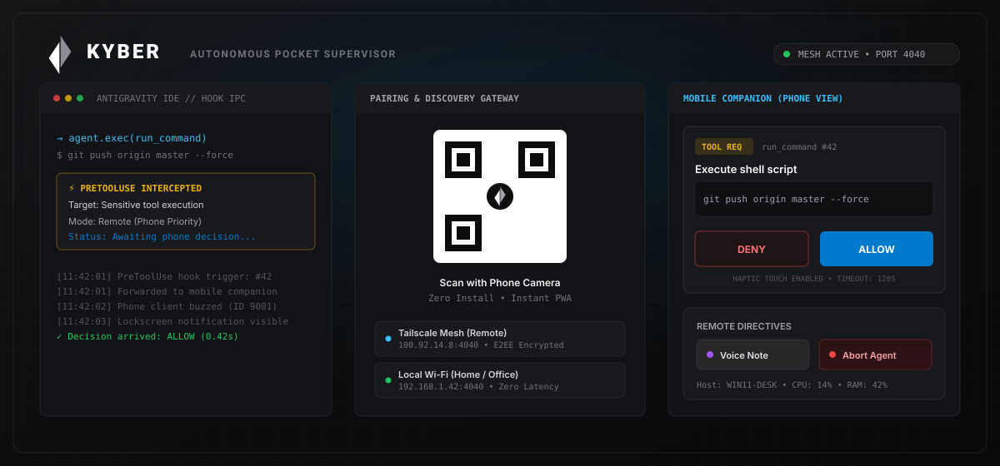

<p align="center">
  
</p>

<h1 align="center">kyber</h1>

<p align="center">
  Local-first mobile supervisor and tool gatekeeper for <strong>Antigravity</strong>, <strong>Codex</strong>, and <strong>Claude Code</strong>.
</p>

<p align="center">
  <a href="#overview">Overview</a> &bull;
  <a href="#features">Features</a> &bull;
  <a href="#architecture">Architecture</a> &bull;
  <a href="#installation">Installation</a> &bull;
  <a href="#core-subsystems">Subsystems</a> &bull;
  <a href="#network-topology">Networking</a> &bull;
  <a href="#security-model">Security</a> &bull;
  <a href="#license">License</a>
</p>

<p align="center">
  
</p>

---

## Overview

When coding agents execute in continuous loops, they inevitably hit tool boundaries requiring operator intervention: shell execution confirmations (`run_command`), destructive file modifications (`write_to_file`), or interactive clarification prompts (`ask_question`). 

Without a supervisor present at the physical terminal, the agent idles at the permission gate, blocking progress.

**Kyber eliminates this bottleneck.** It intercepts agent lifecycle hooks at the IDE process boundary and projects actionable decisions, real-time telemetry, and git diffs directly to a secondary device (Android APK or standalone PWA) over an encrypted local mesh.

### Core Guarantees

* **Zero Cloud Dependency:** Operates strictly over loopback IPC, local Wi-Fi, or peer-to-peer Tailscale meshes. Prompts, diffs, and source code never transit third-party relay servers.
* **Deterministic Fallback:** If the companion daemon terminates or network dropouts occur, the interceptor defaults to `{"decision": "deny"}`, preventing unmonitored agent runaway.
* **Sub-50ms Latency:** Unix named-pipe / TCP loopback IPC resolves approvals in under 50 milliseconds over local interfaces.

---

## Architecture

Kyber operates across three decoupled process boundaries:

```
+-------------------------------------------------------------------+
|                        ANTIGRAVITY IDE / VS CODE                  |
|                                                                   |
|   Agent Tool Invocation (run_command, edit, ask_question)         |
|                               |                                   |
|                               v                                   |
|                     .agents/interceptor.js                        |
|                               |                                   |
|                               v  (Local IPC: Port 4041)           |
+-------------------------------+-----------------------------------+
                                |
+-------------------------------v-----------------------------------+
|                     KYBER DAEMON (Port 4040)                      |
|                                                                   |
|   - Tool Interception Gateway & Approval State Machine            |
|   - Headless Git Working Tree Engine (Status, Diff, Stage)        |
|   - Language Server Quota RPC Adapter                             |
|   - Framebuffer Screen Capture Service                            |
|   - WebSocket Client Synchronizer & Discovery Engine              |
+-------------------------------+-----------------------------------+
                                |
             +------------------+------------------+
             |                                     |
             v                                     v
     Local Area Network                     Tailscale WireGuard
     (Direct IP:Port)                       (Encrypted Mesh)
             |                                     |
             +------------------+------------------+
                                |
+-------------------------------v-----------------------------------+
|                        KYBER MOBILE CLIENT                        |
|             (Android APK / Standalone PWA Engine)                 |
|                                                                   |
|   - [Gate]      Haptic Allow/Deny, Options, & Write-in Prompts    |
|   - [Changes]   Porcelain Git Diffs, Staging, & Direct Commits    |
|   - [Screen]    Desktop Mirror & Dialog Snapshot Fallback         |
|   - [Files]     Active Workspace Editor Tabs & File Tree          |
+-------------------------------------------------------------------+
```

---

## Installation

Choose whichever method fits your development environment:

### Channel 1: Windows 1-Liner (PowerShell)

Open PowerShell and run:

```powershell
irm https://raw.githubusercontent.com/anshul-jpg/Kyber/main/install.ps1 | iex
```

*(Or locally from cloned repo: `powershell -ExecutionPolicy Bypass -File .\install.ps1`)*  
Automatically builds the local extension, installs the global tool interceptor, and boots the background daemon.

### Channel 2: VS Code / Antigravity IDE Extension

1. Install **KYBER** directly from the VS Code Marketplace or download `antigravity-companion-0.1.0.vsix` from [Releases](https://github.com/anshul-jpg/Kyber/releases).
2. Open the **KYBER** view in the Activity Bar.
3. Scan the pairing QR code with your phone camera or navigate to the displayed local URL.

### Channel 3: Standalone CLI Daemon (Headless / SSH / Devcontainers)

For remote dev boxes, SSH sessions, or headless devcontainers:

```bash
# Clone the repository
git clone https://github.com/anshul-jpg/Kyber.git
cd Kyber

# Install dependencies and build
npm install
npm run build

# Start daemon
node packages/cli/dist/bin/agy-companion.js start
```

To attach an individual project workspace:
```bash
node packages/cli/dist/bin/agy-companion.js hook install .
```

---

## Features

* **Unattended Background Supervision:** Persistent Android Foreground Service (`ID 9001`) maintains the supervision loop during deep phone sleep, keeping multi-hour refactors moving without spamming the notification tray.
* **Tactile Approval Gate with Live Diffs:** Sensitive operations (`run_command`, `write_to_file`, file deletions) trigger immediate lockscreen notifications with 1-tap `[Allow]` / `[Deny]` actions and syntax-highlighted line-by-line diff previews.
* **Multimodal Voice Notes:** Record and dispatch raw voice notes directly from mobile into the IDE session, allowing Gemini to natively parse speech and execute complex directives.
* **Live Terminal Stream:** Real-time console output streaming (`stdout`/`stderr`) with exit codes and execution timestamps for long-running compilers and test suites.
* **Headless Git Triage & Commits:** Review porcelain working-tree status, inspect full unified diffs, stage or unstage files, and author atomic commits directly from your phone.
* **Language Server Model Quotas:** Live token telemetry, weekly quota percentages, and rate-limit reset countdowns for Claude 3.5 Sonnet, Claude Opus, and Gemini Flash.
* **Remote Project & Workspace Switching:** Browse host recent IDE projects and hot-swap active agent contexts directly from the mobile drawer.
* **Local-First & Zero-Trust Mesh:** 100% peer-to-peer over local Wi-Fi or encrypted Tailscale WireGuard. Prompts, diffs, and source code never transit third-party relay servers.

---

## Core Subsystems

### 1. Tool Interception & Question Resolution

When an agent requests execution permissions:
* In **Desk Mode**, approvals render as native desktop dialogs inside the IDE.
* In **Remote Mode**, desktop popups are suppressed. Actionable decision payloads forward to the mobile client with tactile vibration feedback.
* **`ask_question` Handling:** Complex multi-choice questions render as interactive chips with custom write-in capabilities, allowing complete architectural direction from mobile.

### 2. Headless Git Working Tree Engine

Exposes porcelain status, diffs, and staging operations without requiring shell access:
* `GET /api/git/status`: Active branch, staged count, modified file paths, and delta stats.
* `GET /api/git/diff`: Line-by-line unified diff calculation with syntax highlighting.
* `POST /api/git/stage` & `POST /api/git/unstage`: Selective staging control.
* `POST /api/git/commit`: Direct atomic commit authoring from the mobile interface.

### 3. Language Server Telemetry

Direct query integration with the underlying IDE language server:
* Streams real-time token quotas, weekly usage percentages, and rate-limit reset countdowns for configured models (Claude 3.5 Sonnet, Claude Opus, Gemini Flash).

### 4. Framebuffer Screen Snapshot

* `GET /api/host/screen.jpg`: Lightweight native screen grab engine for inspecting unhandled system dialogs, browser popups, or external compiler error windows while remote.

---

## Network Topology & Pairing

### Communication Paths

1. **Local Wi-Fi (Sub-5ms):** Direct HTTP/WebSocket connection over local subnet (`192.168.x.x:4040`).
2. **Tailscale Mesh (Global):** Authenticated WireGuard connection across machines without port forwarding (`100.x.x.x:4040`).
3. **Cloudflare Named Tunnel:** Optional TLS tunneling for corporate networks where UDP/P2P is restricted.

---

## Security Model

* **Token-Based Handshake:** Pairings require a cryptographically random hex token generated at daemon initialization. Unauthorized HTTP or WebSocket probes receive `401 Unauthorized`.
* **Zero Telemetry Collection:** Kyber contains no analytic trackers, telemetry beacons, or external reporting endpoints.
* **Loopback Boundary:** Interceptor sockets bind exclusively to loopback addresses (`127.0.0.1`), ensuring process-to-process isolation on multi-user hosts.

---

## Development & Testing

```bash
# Clone and install dependencies
git clone https://github.com/anshul-jpg/Kyber.git
cd Kyber
npm install

# Run complete test suite (12 tests)
npm test

# Build self-contained VSIX extension
npm run package:ext
```

---

## License

Apache-2.0. Copyright &copy; 2026 Anshul.
