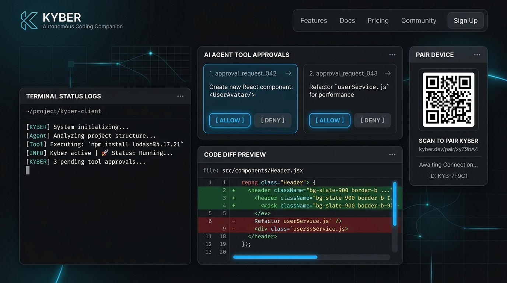

<p align="center">
  
</p>

<h1 align="center">KYBER</h1>

<p align="center">
  <strong>Your AI agent should keep coding while you walk away.</strong><br>
  <em>Autonomous Pocket Supervisor & Real-Time Tool Gatekeeper for Antigravity, Codex & Claude Code.</em>
</p>

<p align="center">
  <a href="#-quickstart-60-second-onboarding"><strong>Quickstart</strong></a> •
  <a href="#-the-problem-why-kyber"><strong>Why Kyber</strong></a> •
  <a href="#-core-capabilities"><strong>Features</strong></a> •
  <a href="#-architecture"><strong>Architecture</strong></a> •
  <a href="#-android-companion-apk"><strong>Android App</strong></a> •
  <a href="#-security--privacy"><strong>Security</strong></a>
</p>

<p align="center">
  
  
  
  
  
</p>

<p align="center">
  
</p>

---

## 💡 The Problem: Why Kyber?

You prompt your AI coding agent with a high-leverage task, leave your desk to grab lunch or make coffee, and come back 30 minutes later.

**Result?** The agent stopped 90 seconds after you walked away, waiting for you to click **"Allow"** on an `npm install`, a file edit, or a clarification question. Your deep work session stalled while your PC sat idle.

**Kyber eliminates the walk-away tax.**

It runs as a silent, background companion daemon integrated into Antigravity IDE and VS Code. When an agent requests a sensitive tool, Kyber pushes an actionable card straight to your smartphone. Tap **Allow**, **Deny**, or dictate a multimodal voice directive—from your pocket, anywhere in your house or across the globe.

---

## ⚡ Quickstart (60-Second Onboarding)

Choose the setup that fits your workflow. Zero cloud subscriptions, zero configuration hurdles.

### Method 1: Windows 1-Liner (Recommended)
Open PowerShell and run the self-install command:
```powershell
irm https://raw.githubusercontent.com/anshul/kyber/master/install.ps1 | iex
```
*(Or locally from cloned repo: `powershell -ExecutionPolicy Bypass -File .\install.ps1`)*

**What this does automatically:**
1. Installs the self-contained `.vsix` into Antigravity IDE.
2. Writes the universal tool interceptor to `~/.gemini/config/hooks.json`.
3. Sets companion mode to `remote` so approvals instantly route to your phone.

---

### Method 2: Antigravity & VS Code Extension (`.vsix`)
The extension package is **100% self-contained** ("batteries included"):
1. Download **`antigravity-companion-0.1.0.vsix`** from the [Releases](packages/vscode-extension/antigravity-companion-0.1.0.vsix) tab.
2. In Antigravity / VS Code: Open Extensions (`Ctrl+Shift+X`) $\rightarrow$ Click `...` $\rightarrow$ **Install from VSIX...**
3. Select the file. The bundled daemon and web engine boot silently in the background.
4. Scan the pairing QR code from the left Activity Bar!

---

### Method 3: Headless Terminal / Remote Dev Server (`npx`)
For SSH sessions, dev containers, Claude Code CLI, or Codex:
```bash
# Start standalone companion daemon with pairing QR
npx kyber-companion start

# Or install tool interceptor globally
npx kyber-companion hook install -g
```

---

## 📱 Mobile Companion & Android APK

Kyber provides two instant mobile experiences:

| Feature | Instant Web Companion (PWA) | Native Android APK |
| :--- | :--- | :--- |
| **Install Friction** | **Zero install** (Scan QR $\rightarrow$ Open in Browser) | Download `.apk` from Releases or Extension |
| **Connectivity** | Local Wi-Fi & Tailscale Mesh | Local Wi-Fi, Tailscale, Cloudflare |
| **Lockscreen Alerts** | Browser notifications | **Native high-priority Android notifications** |
| **Background Vibrate** | While browser tab is open | **Yes (Foreground Service ID 9001)** |
| **Hardware Wake-on-LAN** | Network dependent | **1-Tap Wake dormant PC** |

> **Direct APK Download:** The companion daemon serves the compiled Android APK directly at `http://<your-pc-ip>:4040/download/app.apk`.

---

## ✨ Core Capabilities

### 1. Dual-Mode Governance: Desk vs Remote
Toggle between modes from the status bar or phone with zero friction:
* **Desk Mode:** You are actively at your desk. Tool confirmations appear as standard desktop IDE dialogs. Phone notifications stay silent.
* **Remote Mode:** You stepped away. Desktop confirmation dialogs are suppressed; actionable cards buzz directly on your phone with haptic feedback.
* **Autonomous Mode:** Safe tools execute continuously; critical shell commands queue for single-tap batch clearance.

### 2. Full `ask_question` Support via Mobile QuestionCard
When an agent stops to ask for architectural clarification or design direction, it renders as a native, numbered card on your phone with selectable chips and custom write-in input. Answer complex choices without touching your PC.

### 3. Real-Time Telemetry & Git Diffs
Review exact file changes, git diff snippets, and terminal outputs on mobile before hitting **Approve**.

### 4. Emergency Killswitch
Rogue loop or unexpected delete command? Tap the red **Emergency Stop** button on mobile to instantly terminate execution, pause the agent, and deny pending operations.

### 5. Multimodal Voice Directives
Send spoken voice notes or screenshots from your phone camera directly into the active Antigravity chat session.

---

## 🏗️ Architecture

Kyber follows an **Open Connector local-first design** with zero external cloud dependencies.

```text
┌────────────────────────────────────────────────────────┐
│                   ANTIGRAVITY IDE                      │
│                                                        │
│  Agent Tool Request (run_command / write_to_file)      │
│                     │                                  │
│                     ▼                                  │
│         .agents/interceptor.js                         │
│                     │ (Unix/Named Pipe IPC: 4041)      │
└─────────────────────┼──────────────────────────────────┘
                      ▼
┌────────────────────────────────────────────────────────┐
│             KYBER ENGINE (DAEMON : 4040)               │
│                                                        │
│  - WebSocket Gateway & State Synchronizer              │
│  - Recent Projects Hub & Multi-Workspace Manager       │
│  - E2EE Pairing Key & Ephemeral Ticket Auth            │
└─────────────────────┬──────────────────────────────────┘
                      │
       ┌──────────────┴──────────────┐
       ▼                             ▼
 Local Wi-Fi / Tailscale      Cloudflare Tunnel
       │                             │
       └──────────────┬──────────────┘
                      ▼
┌────────────────────────────────────────────────────────┐
│                MOBILE COMPANION                        │
│   (Web PWA / Android APK Foreground Service: 9001)     │
│                                                        │
│   - Instant Haptic Tool Approval Modal                 │
│   - Live Terminal Output & Code Diff Viewer            │
│   - Voice Directives & Model Directives                │
└────────────────────────────────────────────────────────┘
```

---

## 🔒 Security & Privacy Guarantees

* **Zero Cloud Storage:** Your source code, file contents, prompts, and credentials **never touch an external cloud server**.
* **E2EE Ephemeral Pairing:** The daemon generates a cryptographically random authorization ticket upon launch, verified during handshake.
* **Read-Only Safe Proxy:** Unpaired devices cannot trigger shell executions or approve operations.

---

## 📦 Monorepo Structure

```text
kyber/
├── install.ps1                # Chris Titus-style Windows 1-liner installer
├── install.sh                 # Linux / macOS universal installer
├── assets/                    # Screenshots, logos, and interface banners
├── packages/
│   ├── vscode-extension/      # Antigravity & VS Code extension (bundled VSIX)
│   ├── cli/                   # Standalone daemon, WebSockets & IPC server
│   ├── web/                   # React + Vite mobile PWA & Capacitor Android app
│   └── protocol/              # Shared TypeScript contracts, tickets & schemas
└── package.json               # Monorepo workspace configuration
```

---

## 🧪 Development & Testing

```bash
# Clone and install dependencies
git clone https://github.com/<your-username>/kyber.git
cd kyber
npm install

# Run complete test suite (12 tests)
npm test

# Build self-contained VSIX extension
npm run package:ext
```

---

<p align="center">
  Crafted for autonomous developers who refuse to baby-sit their AI.
</p>
